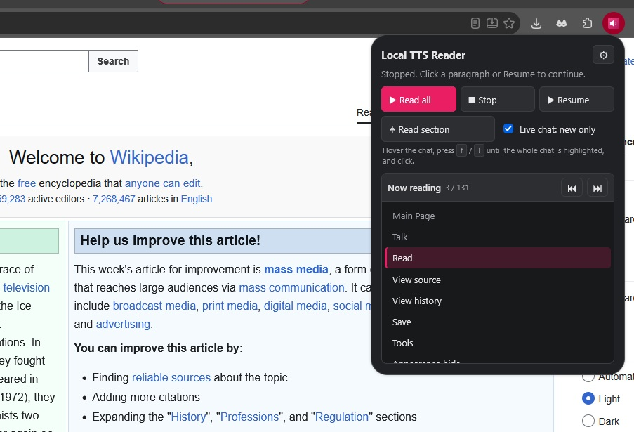
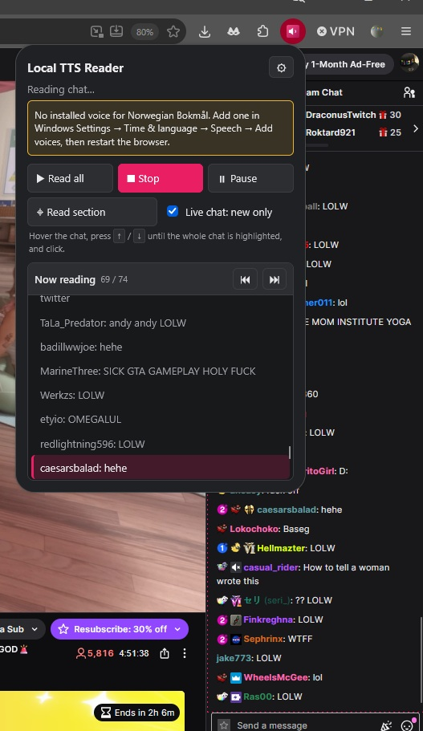
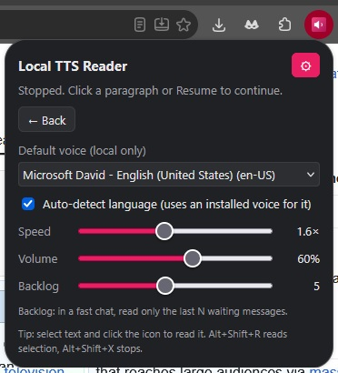

# Local TTS Reader

A browser extension for **Firefox** and **Chrome** that reads text aloud using the voices installed on your device. It can read a selection, a whole page, or a section you pick, such as a live **Twitch** or **YouTube** chat that it keeps reading as new messages arrive.

All speech uses **local voices only**. No cloud TTS, no account, and nothing you read is sent anywhere.



## Install

- **Firefox** (desktop and Android): [Get it on Firefox Add-ons](https://addons.mozilla.org/en-US/firefox/addon/local-tts-reader/)
- **Chrome:** *coming soon*

## Features

- **Read selected text:** select text and click the toolbar icon, use the right-click menu, or press `Alt+Shift+R`.
- **Read all:** reads the main text of the page, paragraph by paragraph.
- **Read section:** pick any area of the page. Hover it, use `↑` / `↓` to grow or shrink the highlight, and click. On touch screens, tap the area and use the **Parent** / **Read this** buttons.
- **Live chat mode:** only new messages are read as they arrive. When the chat is fast, a **backlog** setting keeps only the newest *N* waiting messages, so you stay current.
- **Now reading panel:** shows the paragraphs or messages, highlights the one being read, and lets you click any of them to jump there. **⏮ / ⏭** go back or forward.
- **Pause / Resume / Stop.** Stop keeps the list, so you can continue from any paragraph.
- **A separate list per tab.** Tabs that read at the same time take turns on the single speech channel.
- **Automatic language detection** for each message, done offline. Mixed text such as an English username followed by a Hebrew message is read with a matching voice for each part.
- **Skip menus & navigation** (on by default): Read all leaves out menus, navigation bars and link lists. Turn it off if something you want is skipped.
- **Settings** behind the ⚙ button: default voice, speed, volume, backlog.
- A **⚠** button tells you when a language has no installed voice and how to add one on Windows, macOS, Linux, Android and ChromeOS.

<p>
  
  
</p>

## Voices

The extension uses whatever voices your operating system provides:

| OS | Where to add voices |
|---|---|
| Windows | Settings → Time & language → Speech → Add voices |
| macOS | System Settings → Accessibility → Spoken Content → System voice → Manage Voices |
| Linux | Install `speech-dispatcher` with a voice engine, e.g. `sudo apt install speech-dispatcher espeak-ng` (RHVoice or Piper for more natural voices). Chrome on Linux may need `--enable-speech-dispatcher`. |
| Android | Settings → Text-to-speech |

Restart the browser after installing new voices.

## Keyboard shortcuts (desktop)

| Shortcut | Action |
|---|---|
| `Alt+Shift+R` | Read selected text |
| `Alt+Shift+X` | Stop |

## Build from source

Requires [Node.js](https://nodejs.org/). There are no dependencies.

```sh
node build.mjs
```

This creates the following files. Zips from older versions are deleted on each build.

- `dist/chrome/` and `dist/local-tts-reader-chrome-<version>.zip` for the Chrome Web Store
- `dist/firefox/` and `dist/local-tts-reader-firefox-<version>.zip` for addons.mozilla.org

**Try it without installing:**

- **Chrome:** go to `chrome://extensions`, turn on Developer mode, click **Load unpacked**, and select the project folder.
- **Firefox:** go to `about:debugging#/runtime/this-firefox`, click **Load Temporary Add-on**, and select `dist/firefox/manifest.json`.

## Privacy

Local TTS Reader does not collect, store, or transmit any personal data. Page text is processed only on your device and is spoken with local text-to-speech voices. The only data stored is your settings (voice, speed, volume, backlog), kept in the browser's extension storage.

**Why it asks for access to all websites:** so it can read any page you choose, including chats inside iframes such as YouTube live chat, and keep reading a picked chat as new messages arrive. Scripts run only after you click the extension.

## License

Copyright © 2026. All rights reserved.
